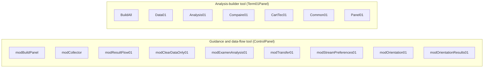
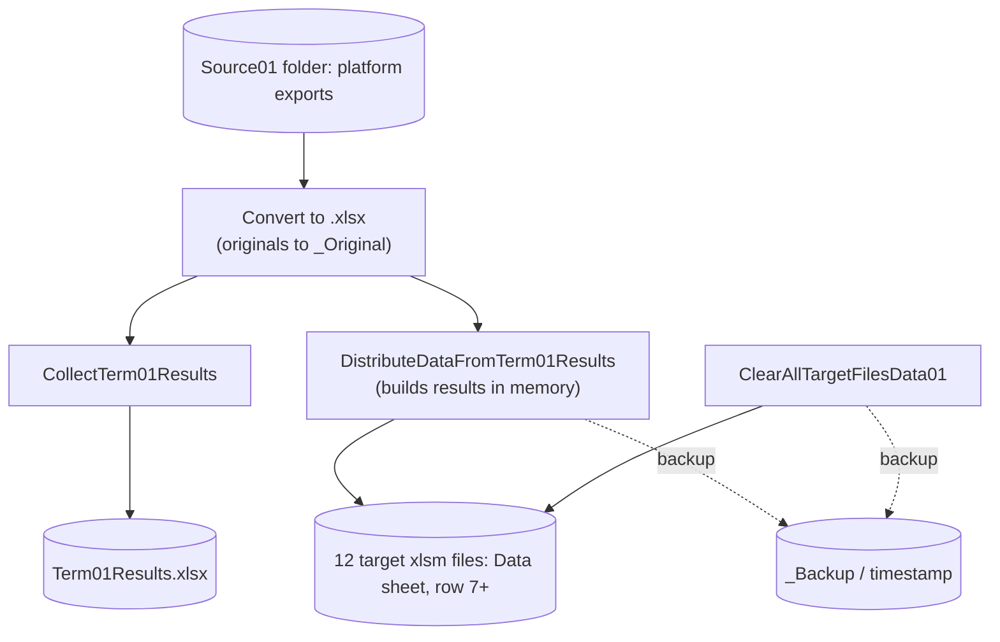
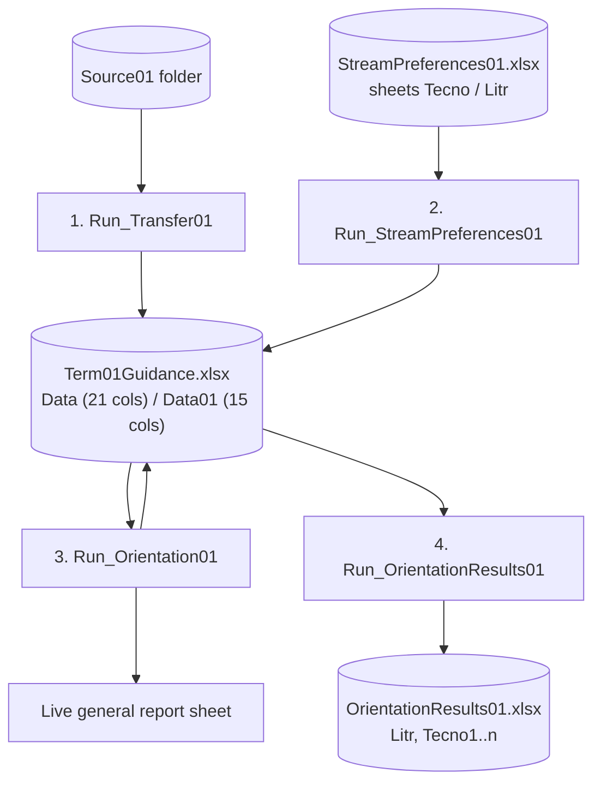
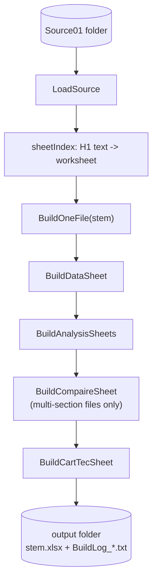

# Architecture

This document describes how the Term 01 toolkit is structured: deployment units, data flow, file contracts, the orientation algorithm, statistical conventions and known technical debt. It is derived from a static reading of the source; nothing here has been inferred from running the code against production data.

## Contents

1. [Scope and design goals](#1-scope-and-design-goals)
2. [Deployment units](#2-deployment-units)
3. [Data flow](#3-data-flow)
4. [File and workbook contracts](#4-file-and-workbook-contracts)
5. [Orientation algorithm](#5-orientation-algorithm)
6. [Analysis builders and statistical conventions](#6-analysis-builders-and-statistical-conventions)
7. [Cross-cutting conventions](#7-cross-cutting-conventions)
8. [Module reference](#8-module-reference)
9. [Known limitations and technical debt](#9-known-limitations-and-technical-debt)
10. [Extension points](#10-extension-points)

---

## 1. Scope and design goals

The toolkit supports one school's first-term processing: marks arrive as spreadsheet exports from the national platform, and must be (a) distributed to class analysis files, (b) used to orient common-core pupils into streams, and (c) analysed statistically.

Design goals visible in the code:

- **Fail closed.** Validate all input before writing; skip rather than guess; never save a half-modified workbook.
- **Reversible.** Back up before modifying, archive instead of deleting.
- **Locale-proof.** Source files are ASCII; Arabic text is built from hex code points (`ChrW`, `AR`, `ArT`, `ArHex`).
- **Independent per term.** Each term gets its own copy of the modules (`...01` suffix), which are deliberately not shared across terms.
- **Operator-friendly.** One macro per task, run from a button panel, with a summary dialog and (for `Build_All`) a text log.

Non-goals: multi-user operation, macOS, cloud-hosted paths, unattended execution.

---

## 2. Deployment units

The `.bas` files are imported into separate **tool workbooks**. The grouping below is derived from cross-module references (`modBuildPanel.PanelActions` binds buttons to specific macros).



The two units share no runtime state. They are linked only by conventions (folder names such as `Source01`, the `Data` sheet layout, and the section-number semantics).

`modBuildPanel` is the only module that knows about other modules. It invokes them through `Application.Run`, using qualified names (`modTransfer01.Run_Transfer01`) where the `VB_Name` must match exactly, and unqualified names for `CollectTerm01Results`, `DistributeDataFromTerm01Results` and `ClearAllTargetFilesData01`.

---

## 3. Data flow

### 3.1 Data-flow pipeline



`DistributeDataFromTerm01Results` embeds the collector logic and builds the merged results workbook **in memory**; it does not read or write `Term01Results.xlsx`. The panel's *First Term Results* and *First Term Analysis* buttons are therefore independent actions.

### 3.2 Orientation pipeline (ordered, guarded)



Step N is enabled only when workflow stage >= N-1 (section 7.3).

### 3.3 Analysis-builder pipeline



`RunBuild` loops over the file map, retries a failed file **once**, and writes a log. Output files are `.xlsx` (formulas, no macros) and are saved with `NextFreePath`, which appends a counter instead of overwriting.

### 3.4 Exam pipeline

`Run_ExamenAnalysis01` reads every `.xlsx` in `ExamenSource01\`, consolidates marks per cohort (`Philo`, `LEtr`, `SE01`, `SE02`, `Math`, `GEc`), computes weighted semester averages in VBA, and saves a new workbook next to the tool: a general sheet, six class sheets, and a data-transfer summary. Analysis cells are written as static values.

---

## 4. File and workbook contracts

### 4.1 Source workbooks (`Source01`)

| Item | Contract |
|---|---|
| Identity of a sheet | Text in merged cell `H1` (normalised). Prefix identifies the track, trailing number identifies the section. |
| Raw platform export | Header at row 6 (`DATA_START_ROW = 6`); the last row is treated as a footer (`TRAILING_ROWS_SKIP = 1`) |
| Collected workbook | Header row 2, data from row 3 (what `Transfer` reads) |
| Header validation | `Transfer` checks each mapped header against expected Arabic keywords before reading data |
| Section number | Taken from the last two characters of the normalised `H1` text (`ResultFlow`) or from a positive integer after the prefix (`Transfer`) |

### 4.2 `Term01Guidance.xlsx`

**Science sheet `Data`**, table `Data`, anchored at `A2`, 21 columns:

| Col | Content | Col | Content |
|---|---|---|---|
| A | Number | L | Technology |
| B | Name | M | Term average |
| C | Birth date | N | Section (ignored by orientation) |
| D | Sex | O | Wish 1 |
| E | Repeater flag | P | Wish 2 |
| F | Arabic | Q | Profile: Mathematics |
| G | Mathematics | R | Profile: Technical mathematics |
| H | Physics | S | Profile: Experimental sciences |
| I | Natural sciences | T | Profile: Management & economics |
| J | History-Geography | U | Orientation suggestion |
| K | Informatics | | |

Source columns copied: `1,2,3,4,5,6,7,8,9,11,14,15,19` -> target `A..M`.

**Profile formulas** (computed in VBA in `modTransfer01.FillProfiles`, stored as rounded values, blank if any component is missing):

| Profile | Formula |
|---|---|
| Q Mathematics | `(Math*6 + Physics*4 + Arabic) / 11` |
| R Technical math | `(Technology*4 + Math*3 + Physics*3 + Arabic) / 11` |
| S Experimental | `(NatSci*4 + Math*3 + Physics*3 + Arabic) / 11` |
| T Management | `(HistGeo*4 + Math*4 + Informatics + Arabic*2) / 11` |

**Arts sheet `Data01`**, table `Data`, 15 columns: `A` number, `B` name, `C` birth, `D` sex, `E` repeater, `F` Arabic, `G` History, `H` French, `I` English, `J` term average, `K`/`L` wishes, `M` language profile, `N` arts profile, `O` decision.

| Profile | Formula |
|---|---|
| M Language | `((Arabic + French + English)*3 + History) / 10` |
| N Arts | `(Arabic*5 + French*2 + English + History*2) / 10` |

Sheets are protected with an empty password. All cells are locked except the two wish columns; `modOrientation01` additionally unlocks the decision column.

### 4.3 `StreamPreferences01.xlsx`

| Sheet | Target | Layout |
|---|---|---|
| `Tecno` | `Data` | headers row 2, data from row 3; `B` name, `C` birth, `D` wish 1, `E` wish 2 |
| `Litr` | `Data01` | same layout; wishes written to `K:L` |

Records are matched to pupils by `NameKey` (normalised name) plus `DateKey` (birth date):

1. Full key match, if unique in the target.
2. Name-only match when the name is unique in the target and one of the dates is missing.
3. Otherwise rejected: *name not found*, *birth date mismatch*, *ambiguous name (no date)*, *duplicate in target*.

Duplicates in the source (two records for one pupil, or two records resolving to the same target row) invalidate **all** involved records. Unknown wish text is imported as empty with a warning; wish 1 = wish 2 is rejected.

### 4.4 Distribution targets

12 workbooks, each with a `Data` sheet (header row 6, data from row 7, section column located by header text):

```text
1LitAnalysis01     1TecnoGlobalAnalysis01 (4 sections)
2GEAnalysis01      2LEAnalysis01   2MathAnalysis01   2PhiloAnalysis01   2SEGlobalAnalysis01 (2 sections)
3GEAnalysis01      3LEAnalysis01   3MathAnalysis01   3PhiloAnalysis01   3SEGlobalAnalysis01 (2 sections)
```

Sections are written consecutively from row 7; the section number is written in the column immediately after the last copied column.

### 4.5 Analysis-builder output workbook

| Sheet | Purpose |
|---|---|
| `Data` (table `Data`, header row 6, first row 7) | Term marks plus the model-specific extra columns (previous-year averages, exam results, notes) |
| `Analysis01` | One block per section; statistics from formulas |
| `AnalyseCompaire` | Cross-section comparison (only for multi-section files) |
| `Cart_Tec` | Student technical card (previous year / exam or difference / term 1) |

### 4.6 `OrientationResults01.xlsx`

Sheet `Litr` for arts (original order) and one sheet per science section (`Tecno1`, `Tecno2`, ...), sorted by term average descending with a rank column; the section column is removed. The source workbook is opened read-only.

---

## 5. Orientation algorithm

Implemented in `modOrientation01`. Science and arts are independent tracks, run in one call; the workbook is saved only after both succeed.

### 5.1 Parameters

| Parameter | Value | Notes |
|---|---|---|
| Pass mark | 10 | Compared with `>= PASS_MARK - EPS` (`EPS = 1e-6`) |
| Top share | 5% | Nearest integer, halves up (science); ceiling (arts) |
| Seat ceilings (science) | Math 18% floor, Tech 22% floor, Exp 55% ceiling, Mgmt 100% ceiling | Ceilings, not quotas: branches may stay under their ceiling |
| Arts language seats | normal 20% ceiling, maximum 25% floor | |
| Compatibility gap | 1.00 | An alternative must exceed wish 1 by *more* than this to reject it |
| Profile exemption | `> 12.99` on all four profiles | Exempts wish 1 from subject conditions; experimental and management only |

Percentages use `Decimal` arithmetic to avoid binary drift (`ShareCount`, `ShareCountUp`, `ShareCountNearest`).

### 5.2 Classification (science)

For each pupil, in order:

1. **Passer:** term average >= 10.
2. **Failing repeater** (column E equals the "yes" token): *Orientation*.
3. **Failing, not a repeater:** birth year >= `workYear - 17` -> *Repeat year*; otherwise *Orientation*.
4. Unreadable average or birth date: left blank and counted as an issue.

`workYear` is `Year(Date)` unless `WORK_YEAR_OVERRIDE > 0`.

### 5.3 Assignment (science)

```text
sort table by term average (desc); build passers list
caps(1..4) = floor/floor/ceil/ceil of shares * nPassers

Phase 0  Top 5%: grant wish 1 unconditionally (no subject, profile or capacity test);
         these seats still count against the ceilings.
Phase 1  For round r in {1, 2}:            (wish 1, then wish 2)
           for branch b in {Math, Tech, Exp, Mgmt}:
             candidates = unassigned pupils whose wish r == b and Eligible(b)
             rank by: profile(b) > math > physics > natural sci > term average
             admit in rank order while seats remain,
             re-checking Eligible with the pupil's real alternative (round 1)
Phase 2  Leftovers: best remaining branch among {Exp, Mgmt} by profile.
         Error if none is eligible (no suggestion is written).
Phase 3  RestoreFirstWishes: repeatedly move pupils to their wish 1 when a seat
         has become free and they are eligible, until no change.
Checks   branch totals == passers; classification totals == pupils; no ceiling exceeded.
```

### 5.4 Subject conditions (`Allowed`)

| Branch | Condition |
|---|---|
| Management | Management profile exists |
| Mathematics | Math >= 10 **and** Physics >= 10 |
| Technical mathematics | Not (Math < 10 and Physics < 10) and not (min(Math, Physics) < 9 and Math + Physics < 20) |
| Experimental sciences | Not (NatSci < 10 and Math < 10), not (NatSci < 10 and Physics < 10), not (Math < 10 and Physics < 10 and NatSci < 11) |

An explicit request for experimental sciences with Math, Physics and NatSci all >= 10 is accepted regardless of the above. Mathematics and technical mathematics conditions can never be bypassed.

### 5.5 Profile compatibility (`Compat`)

In round 1, wish 1 is compared with the **actual proposed alternative** (wish 2 if eligible with a seat, otherwise the best remaining experimental/management option), never with the highest profile in general. If `profile(alternative) - profile(wish 1) > 1.00`, wish 1 is refused in that round and the pupil proceeds to round 2.

### 5.6 Arts track

1. Passers (average >= 10) default to *Arts & Philosophy*.
2. Top 5% (ceiling): wish 1 granted unconditionally.
3. Language seats are filled in three tiers, only for pupils with **both** French and English >= 10:
   - Tier 1: wish 1 = languages.
   - Tier 2: conversion when `languageProfile - artsProfile > 1.00` (stops at the normal 20% total).
   - Tier 3: wish 2 = languages while wish 1 is empty.
4. Within a tier, ranking is by language profile, then (French + English)/2, then English.
5. Totals and the language ceiling are re-verified before writing.

### 5.7 Failure model

- Pre-run validation (`ValidateGuidanceData`, `ValidateArtsData`) lists up to 20 problem cells.
- Any runtime error aborts before the decision column is written.
- If the guidance workbook was opened by the macro, it is closed without saving on failure. If it was already open, in-memory changes (including the table re-sort) remain unsaved and the user is warned.

---

## 6. Analysis builders and statistical conventions

### 6.1 Shared conventions

| Convention | Rule |
|---|---|
| Present mark | `> 0` (zero means absent) |
| Success rate | `COUNTIFS(col, ">=10") / COUNTIFS(col, ">0")` |
| Mean | `AVERAGEIFS(col, col, ">0")` |
| Median | `AGGREGATE(17, 6, col / mask, 2)` |
| Mode | `MODE.SNGL(IF(mask, col))`, entered via `Formula2` with `FormulaArray` fallback |
| Max / Min | `MAXIFS` / `MINIFS` with `>0` |
| Standard deviation | **Population** (`SQRT(SUMPRODUCT(mask*(x-mean)^2) / n)`); variance accordingly |
| Section filter | `COUNTIFS(sectionCol, secN, ...)` or `(section=secN)*(col>0)` masks |

### 6.2 `modExamenAnalysis01`

Computes the same indicators in VBA (`CalcColStat`): population SD, median by sorting, mode by O(n^2) scan (no mode if all values are distinct), mark bands (`<7, <9, <10, <12, <14, <16, <18, >=18`) and five standard-deviation classes around the mean.

Weighted average per pupil: `round(sum(coef*mark) / sum(coef), 2)` over numeric marks. Blank cells are treated as exempt for that pupil; a non-numeric absence token makes the average that text. Subject recognition uses exact keywords first, then a one-wrong-letter fallback accepted only when exactly one subject matches; every guess is written to the transfer summary sheet.

### 6.3 Layout and styling

`Common01` centralises constants (sheet names, formats such as `00.00` and `[=1]%0;%00.00`, row heights, fonts), font probing (`PickFont`, `FontAvailable`, `MeasureWidth`) and discovery of the `Data` table's structure (`DiscoverData`, `FindSubjCol`, `SubjKey`). Subject columns are located by normalised Arabic keywords so that the cards follow whatever model columns a file contains.

---

## 7. Cross-cutting conventions

### 7.1 Entry-point pattern

```text
validate environment (saved, local path)
save Application state (ScreenUpdating, EnableEvents, DisplayAlerts, ...)
On Error GoTo handler
  open / build in memory
  validate everything
  write
  save
cleanup: close what the macro opened, restore Application state
report: one summary MsgBox (plus log file in Build_All)
```

Modules that expose success to the panel keep a module-level `m_runSucceeded` and a public `...Succeeded()` function (`Transfer01Succeeded`, `Preferences01Succeeded`, `Orientation01Succeeded`, `OrientationResults01Succeeded`).

### 7.2 File-safety rules

- Skip workbooks that are already open in the session (`IsWorkbookOpen`), opened read-only, or missing the expected sheet.
- Copy before modify (`_Backup\<yyyymmdd_hhnnss>`); suffix with a counter if the folder exists.
- Save only after all steps for that file succeeded; otherwise close with `SaveChanges:=False`.
- Open source files with `UpdateLinks:=False`, `ReadOnly:=True`, `AddToMRU:=False`, and `AutomationSecurity = msoAutomationSecurityForceDisable` where `.xlsm`/`.xls` files are opened.

### 7.3 Workflow state (`modBuildPanel`)

Stage 0-4 is stored in hidden workbook-level names (`_Term01_Stage`, `_Term01_Guidance`, `_Term01_Wishes`, `_Term01_Export`). The three file names carry a **stamp** (`size|yyyymmddhhnnss`) captured after each successful step.

On every click, `TermWorkflowStage01` recomputes the effective stage: if a stamped file is missing or its stamp differs, the stage falls back (to 0, 1 or 3 respectively). Before running a step the stage is saved as `step - 1`, so a cancelled or failed retry invalidates all later completions. The state is persisted only when the tool workbook is saved.

`WorkflowFile01` contains an optional full-content checksum path (`fullHash`), which is currently never requested.

### 7.4 Text and fonts

- All Arabic literals are hex code points; helper names are `AR`, `ArT`, `ArHex`, `Txt`, `ArtsText`, `L`.
- `NormKey` / `NormAr` / `Norm` strip control and bidirectional marks, normalise hamza and similar variants, and trim.
- Fonts are probed (registry for installed fonts, then measurement on a scratch cell) and fall back to Arial/Calibri; replacements are reported in the log.

### 7.5 Locale handling

Marks stored as text are normalised in `NormalizeMark` using `Application.International(xlDecimalSeparator)`. Formulas are written in English syntax through `.Formula`; the conditional-formatting helper `LocalFormulaText` converts where local syntax is required. `CStr(PASS_MARK)` is embedded in some formulas, which is safe for the current integer value only.

---

## 8. Module reference

| Module | Public entry points | Reads | Writes |
|---|---|---|---|
| `modBuildPanel` | `BuildControlPanel`, `RefreshPanelState`, `RunTermStep01`, `*Guard` | workbook names, file stamps | `ControlPanel` sheet, hidden names |
| `modCollector` | `CollectTerm01Results`, `ProcessSingleSourceFile`, `CollectAllSources` | `Source01\` | `Term01Results.xlsx`, `Source01\_Original\` |
| `modResultFlow01` | `DistributeDataFromTerm01Results` | `Source01\`, targets | targets (`Data` row 7+), `_Backup\` |
| `modClearDataOnly01` | `ClearAllTargetFilesData01` | targets | targets (rows 7..last, cols 1..section), `_Backup\` |
| `modTransfer01` | `Run_Transfer01`, `Transfer01Succeeded` | `Source01\` | `Term01Guidance.xlsx` (`Data`, `Data01`) |
| `modStreamPreferences01` | `Run_StreamPreferences01`, `Preferences01Succeeded` | `StreamPreferences01.xlsx` | wish columns in `Term01Guidance.xlsx` |
| `modOrientation01` | `Run_Orientation01`, `RefreshReports01`, `Orientation01Succeeded` | `Term01Guidance.xlsx` | decision column, summary sheets, general report |
| `modOrientationResults01` | `Run_OrientationResults01`, `OrientationResults01Succeeded` | `Term01Guidance.xlsx` (read-only) | `OrientationResults01.xlsx` |
| `modExamenAnalysis01` | `Run_ExamenAnalysis01` | `ExamenSource01\*.xlsx` | new workbook next to the tool |
| `...BuildAll01` | `Build_All`, `Build_One` | all of the below | output folder, `BuildLog_*.txt` |
| `...Data01` | `LoadSource`, `GetFileMap`, `GroupReady`, `BuildDataSheet` | `Source01\` | `Data` sheet |
| `...Analysis01` | `BuildAnalysisSheets`, `CoreKeysFor` | `Data` | `Analysis01` |
| `...Compaire01` | `BuildCompaireSheet` | `Data` | `AnalyseCompaire` |
| `...CartTec01` | `BuildCartTecSheet` | `Data` | `Cart_Tec` |
| `...Common01` | constants, styles, `DiscoverData` | workbook | none |
| `...Panel01` | `Panel_Create`, `Panel_Update`, `Panel_Reset`, `Panel_Finish`, `Panel_Show`, `Panel_OpenOutput` | | `Term01Panel` sheet |

---

## 9. Known limitations and technical debt

Ordered by impact. Each item is a risk identified by reading the code.

1. **Run-date dependence.** `Year(Date)` drives the *Repeat year* rule in both tracks (`modOrientation01`). Re-running in another calendar year can change decisions. Mitigation: set `WORK_YEAR_OVERRIDE`, or persist the school year in the workbook.
2. **Inconsistent meaning of `0`.** Analysis formulas and `IsPresent` treat `0` as absent. `Transfer`/`Orientation` treat it as a valid mark. `Examen` averages it as a mark but excludes it from subject statistics.
3. **Distribution assumes layout it does not verify.** `ResultFlow` pastes from column 1 and writes the section number at `LastCol + 1` without checking that this is the target's section column. Its `ClearDataArea` falls back to the last used header column when the section header is not found, and does not strip bidirectional marks when matching it. `ClearDataOnly`'s variant refuses to proceed in that situation.
4. **Orientation is all-or-nothing on one data gap.** `Err.Raise` 56 aborts the run if a passer has no eligible leftover branch (in practice, a missing management profile). The table is also re-sorted in place on the user's sheet.
5. **Workflow state fragility.** State lives in hidden names (lost if the tool workbook is not saved). Manual wish edits change the file stamp and drop the stage. Running `Run_*` directly bypasses the panel guard. The `fullHash` branch is unused.
6. **Source conversion bookkeeping.** In the three copies of `ConvertSourceFilesToXLSX`, the converted counter increases even when moving the original fails (error suppressed), leaving the original in place and counted as failed on later runs. `.xlsm` conversion drops macros. `Collector` overwrites `Term01Results.xlsx` without confirmation and restores `EnableEvents` / `DisplayAlerts` to `True` rather than their previous values; `Orientation` forces `xlCalculationAutomatic`.
7. **Duplicated code.** About 56 procedure names appear in more than one module (e.g. `TryBirthDate`, `Norm`, `ArtsText`, `SrcProcessFile`, `ConvertSourceFilesToXLSX`, `PlaceHeaderTitle`, `SplitAtSchoolYear`). Most copies are identical; real divergences exist in `IsNum`, `LockAndProtect`, `IsWorkbookOpen`, `ClearDataArea`, and the `Data01` variants of `SrcProcessFile` / `SrcBuildWorkbook`. `Transfer`, `StreamPreferences` and `Orientation` always run together against one workbook and are the strongest candidates for a shared module.
8. **School-specific constants.** File map, required section counts (`1TecnoGlobal` 4, `SEGlobal` 2), coefficient tables (`SheetCoefs`), `MAX_STUDENTS`, the Arabic file/sheet prefixes, and the directorate and school names printed in the orientation report headers (`modOrientation01`) are hard-coded in several places. With `ALLOW_PARTIAL = False`, one absent section skips its whole target file.
9. **Magic numbers.** `Allowed()` uses literals (10, 9, 20, 11) rather than `PASS_MARK`; `PASS_MARK` itself is defined in three modules.
10. **Error suppression.** Over 100 `On Error Resume Next` statements (highest in `ResultFlow`, `Transfer`, `Data01`, `Collector`). Several guard legitimate optional operations, but they can mask unexpected failures.
11. **Missing duplicate-section check in `Transfer`.** Two source sheets with the same group number are both transferred; the analysis builders do detect duplicate keys (`dupKeys`), `Transfer` does not.
12. **Smaller items.** Mixed `"\"` and `Application.PathSeparator`; `MsgBox` text truncated at 1000 characters in `Build_All`/`Examen`; `Build_All` output accumulates numbered copies; stale comment in `modOrientationResults01` (arts sheet is `Litr`, not `01`); default blank sheet in `Term01Results.xlsx` is only removed when its name starts with the English "Sheet".
13. **No automated tests.** Highest-value targets: orientation with 1-12 passers, tied averages, all pupils requesting one branch, and the date-boundary case in item 1.

---

## 10. Extension points

| Need | Where to change |
|---|---|
| Different seat shares, age rule or pass mark | Constants at the top of `modOrientation01` |
| New school / different classes | File map in `modResultFlow01`, `modClearDataOnly01`, `GetFileMap` in `Data01`; `CoreKeysFor` in `Analysis01` |
| New subject or coefficients (Examen) | `SheetIds`, `SheetCoefs`, `SubjectIdOf`, `SubjectIdFuzzy` |
| Term 2 / Term 3 | Copy the modules, change the `01` suffix, folder names and Arabic prefixes; keep the copies independent |
| New orientation branch | `Eligible` / `Allowed` / `Compat`, capacity array, `WishBranch`, `g_br`, report builder |
| Pin the school year | `WORK_YEAR_OVERRIDE` in `modOrientation01` |
