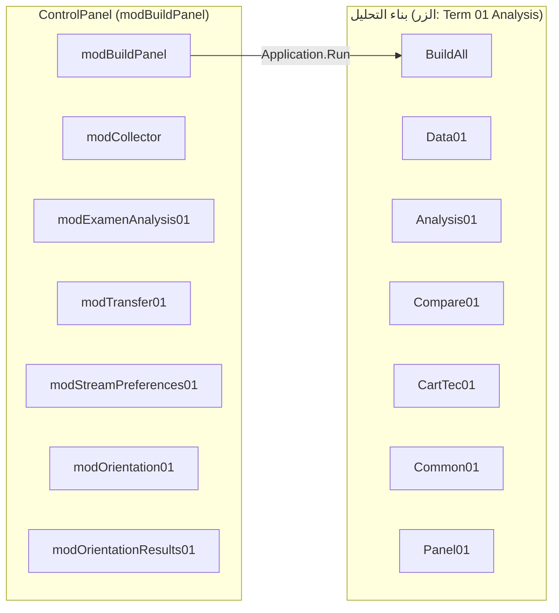
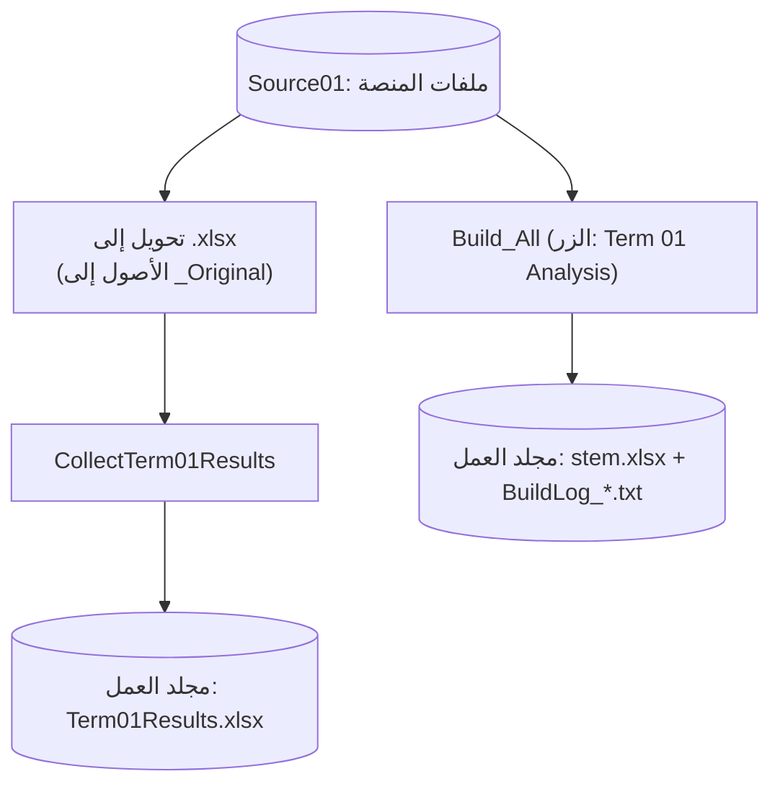
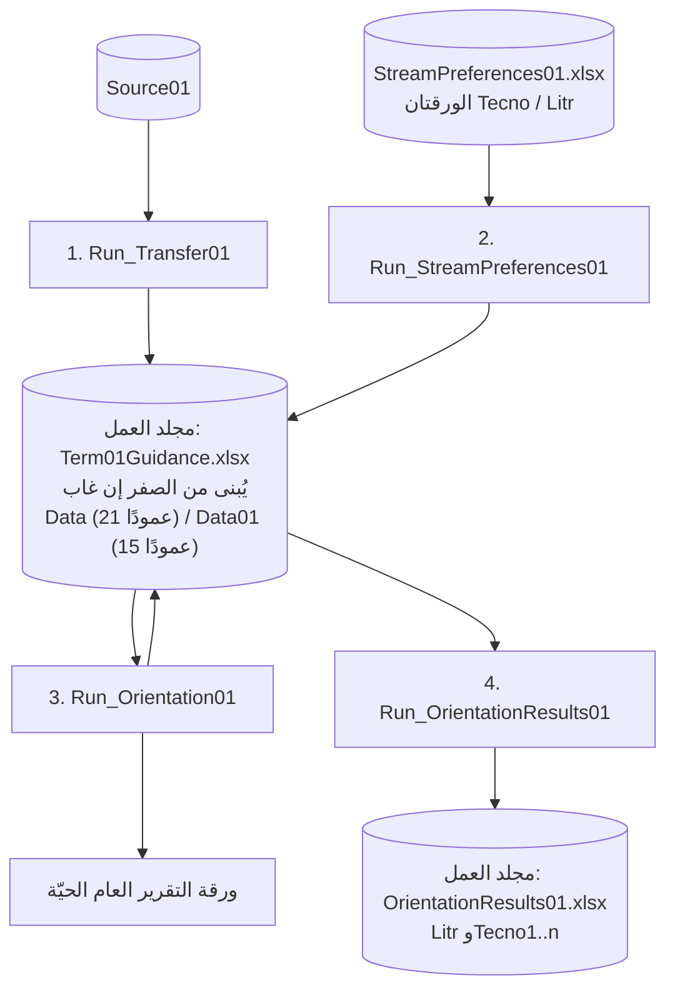
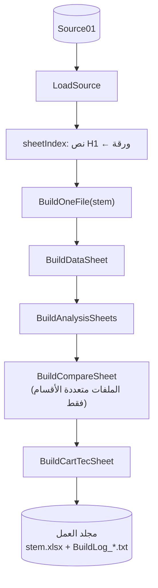
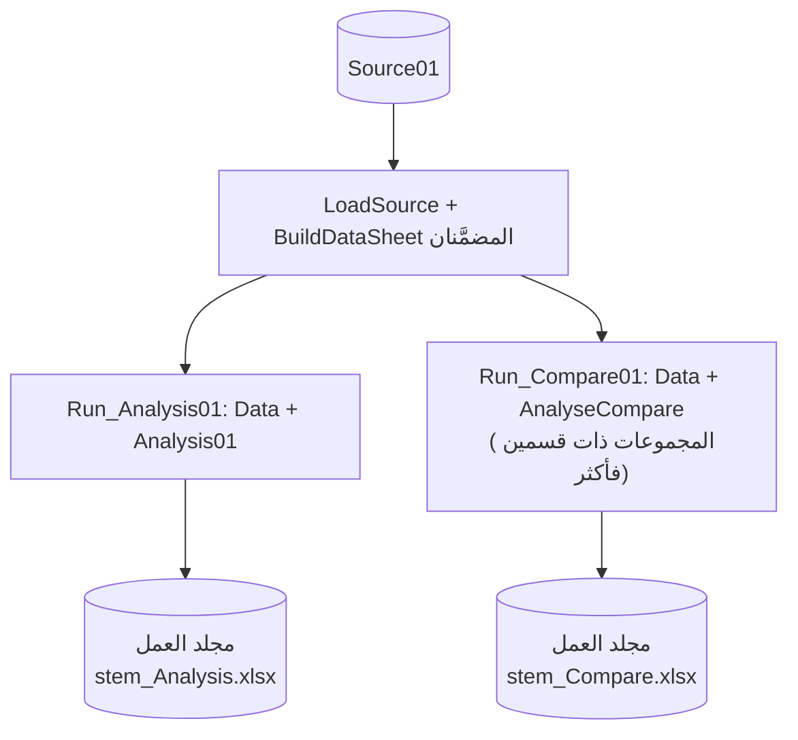

# البنية المعمارية

<div dir="rtl">

تصف هذه الوثيقة بنية حزمة الفصل الأول: وحدات النشر وتدفق البيانات وعقود الملفات وخوارزمية التوجيه والأعراف الإحصائية والدين التقني. وهي مستخلصة من **قراءة ساكنة** للشيفرة؛ ولم يُستنتج شيء منها بتشغيل الشيفرة على بيانات حقيقية.

## المحتويات

1. [النطاق وأهداف التصميم](#1-النطاق-وأهداف-التصميم)
2. [وحدات النشر](#2-وحدات-النشر)
3. [تدفق البيانات](#3-تدفق-البيانات)
4. [عقود الملفات والمصنَّفات](#4-عقود-الملفات-والمصنفات)
5. [خوارزمية التوجيه](#5-خوارزمية-التوجيه)
6. [بناة التحليل والأعراف الإحصائية](#6-بناة-التحليل-والأعراف-الإحصائية)
7. [الأعراف المشتركة](#7-الأعراف-المشتركة)
8. [مرجع الوحدات](#8-مرجع-الوحدات)
9. [القيود المعروفة والدين التقني](#9-القيود-المعروفة-والدين-التقني)
10. [نقاط التوسعة](#10-نقاط-التوسعة)

---

## 1. النطاق وأهداف التصميم

تخدم الحزمة المعالجة الفصلية لمؤسسة واحدة: تصل العلامات في ملفات جداول مصدَّرة من المنصة الرقمية، ويجب (أ) جمعها وبناء ملفات تحليل لكل مجموعة أقسام، و(ب) استعمالها في توجيه تلاميذ الجذع المشترك إلى الشعب، و(ج) تحليلها إحصائيًا، بما في ذلك تحليل نتائج الاختبارات حسب المستوى.

أهداف التصميم الظاهرة في الشيفرة:

- **الفشل الآمن.** التحقق من كل المدخلات قبل الكتابة، والتخطّي بدل التخمين، وعدم حفظ مصنَّف نصف معدَّل أبدًا.
- **عدم الإتلاف.** لا حذف ولا استبدال صامت: الأصول تُؤرشف، وأسماء المخرجات الجديدة تُرقَّم بدل أن تُكتب فوق ملف قد يكون عُدِّل يدويًا، ولا يُحفظ مصنَّف إلا بعد نجاح كل خطواته.
- **مقاومة الإعدادات الإقليمية.** ملفات الشيفرة ASCII، والنص العربي يُبنى من أكواد Unicode (`ChrW` و`AR` و`ArT` و`ArHex`).
- **الاستقلال بين الفصول.** لكل فصل نسخته من الوحدات (لاحقة `...01`)، ولا تتشارك الفصول الشيفرة عمدًا.
- **سهولة التشغيل.** ماكرو واحد لكل مهمة، يُشغَّل من لوحة أزرار، مع رسالة ملخّص وسجل نصي (في `Build_All` والماكروين المستقلين).

خارج النطاق: تعدّد المستخدمين، وmacOS، والمسارات السحابية، والتشغيل غير المراقَب.

---

## 2. وحدات النشر

تُستورد ملفات `.bas` في **مصنَّف أداة** (يوصى بمصنَّف واحد للجميع؛ ويمكن أن تعيش وحدات بناء التحليل وحدها في مصنَّف منفصل بورقة `Term01Panel` الخاصة بها). وتربط `modBuildPanel.PanelActions` أزرار `ControlPanel` بماكروهات المجموعتين:



الوحدات `Transfer` و`Analysis01` و`Compare01` **مستقلة**: تقرأ كل منها ملفات `Source01` الخام بنفسها (نسخة مضمّنة من محرك `Collector01`) وتكتب في مجلد العمل. وتستعمل `Analysis01` و`Compare01` وحدة `Common01` المشتركة (الثوابت والأنماط و`DiscoverData`)، وهي مكتبة وليست خطوة في مسار العمل. ولم تعد `Compare01` تستدعي `Analysis01`: فهي تحمل نسختين خاصتين من `PutModeFormula` و`ApplyPassColors`.

`modBuildPanel` هي الوحدة الوحيدة التي تعرف الوحدات الأخرى. تستدعيها عبر `Application.Run` بأسماء مؤهَّلة (`modTransfer01.Run_Transfer01` و`modBiuldAnalysisfilesBuildAll01.Build_All`) حيث يجب أن يطابق `VB_Name` تمامًا، وبالاسم غير المؤهَّل `CollectTerm01Results`. وعندما لا توجد ورقة `Term01Panel` تعود إجراءات `Panel01` التي تستدعيها `Build_All` بصمت.

كل وحدة تكتب ملفًا تبحث عن **مجلد العمل** بالاسم بجوار الأداة وتنشئه إن غاب: أول وحدة تعمل تُنشئه. أما الوحدات التي تقرأ منه فقط فلا تُنشئه أبدًا.

---

## 3. تدفق البيانات

### 3.1 مسار التجميع والبناء



تقرأ `CollectTerm01Results` و`Build_All` ملفات `Source01` الخام كلتاهما؛ ولا تقرأ `Build_All` الملف `Term01Results.xlsx`.

### 3.2 مسار التوجيه (مرتَّب ومحروس)



لا تُفعَّل الخطوة N إلا إذا كانت مرحلة سير العمل ≥ N-1 (القسم 7.3).

### 3.3 مسار بناة التحليل



**النسختان المستقلتان.** يستعمل `Run_Analysis01` و`Run_Compare01` المحرك نفسه، لكن كلًّا منهما يبني أوراقه فقط ويكتب في مجلد العمل:



تدور `RunBuild` على خريطة الملفات، وتعيد محاولة الملف الفاشل **مرة واحدة**، وتكتب سجلًا. وملفات المخرجات `.xlsx` (بصيغ دون ماكرو) تُحفظ بـ`NextFreePath` التي تضيف عدّادًا بدل الاستبدال.

### 3.4 مسار الاختبارات

يقرأ `Run_ExamenAnalysis01` كل ملف `.xlsx` في `ExamenSource01\` (وتُهمل أي ورقة اسمها `Worksheet` بأي حالة أحرف)، ويصنّف كل قسم حسب **المستوى** ويجمع علاماته، ويحسب المعدلات الفصلية المرجَّحة في VBA، ويحفظ **مصنَّفًا جديدًا لكل مستوى فيه بيانات** داخل مجلد العمل. وتُكتب خلايا التحليل قيمًا ثابتة.

| المستوى | الأقسام (أسماء الأوراق) | اسم الملف الناتج (تُضاف لاحقة رقمية إن وُجد) |
|---|---|---|
| أولى ثانوي (جذع مشترك) | `Lit` و`ST01` و`ST02` و`ST03` و`ST04` | `تحليل نتائج اختبارات مستوى أولى ثانوي` |
| ثانية ثانوي | `Philo` و`LEtr` و`SE01` و`SE02` و`Math` و`GEc` | `تحليل نتائج اختبارات مستوى ثانية ثانوي` |
| ثالثة ثانوي | `Philo` و`LEtr` و`SE01` و`SE02` و`Math` و`GEc` | `تحليل نتائج اختبارات مستوى ثالثة ثانوي` |

يضم كل ملف ورقة `Gen` الخاصة بمستواه (المسجلون والحاضرون والغائبون والنتائج العامة لكل قسم؛ و**لا** توجد مقارنة مع المواسم الماضية ولا بين الفصول)، وورقة لكل قسم فيه بيانات، وورقة ملخّص النقل (مدخلات ذلك المستوى فقط؛ وتظهر ملاحظات المعالجة في كل ملف). والقسم الذي لا بيانات له لا تُنشأ له ورقة ولا سطر في `Gen`؛ والمستوى الذي لا بيانات له لا يُنتَج له ملف.

**اكتشاف المستوى والقسم.** يُطبَّع اسم الفوج المقروء من الخلية `A5` (`SmartClean`) ويُبحث فيه عن `ثالثة` ثم `ثانية` ثم `أولى` (`LevelOfName`). وفي الثانية والثالثة تُستعمل بعدها كلمات الشعبة (آداب؛ لغات **و**ألمانية؛ علوم **و**تجريبية مع آخر رقم 1 أو 2؛ رياضيات؛ تسيير). وفي الأولى تدل `آداب` على `Lit`، وآخر رقم من 1 إلى 4 على `ST01` إلى `ST04`. والفوج الذي يتعذّر تصنيفه يُذكر في ورقة الملخّص ولا يُسقَط بصمت.

---

## 4. عقود الملفات والمصنفات

### 4.1 مصنَّفات المصدر (`Source01`)

| العنصر | العقد |
|---|---|
| هوية الورقة | النص في الخلية المدموجة `H1` (بعد التطبيع). تحدد البادئة المسار ويحدد الرقم الأخير القسم. |
| تصدير المنصة الخام | صف العناوين هو الصف 6 (`DATA_START_ROW = 6`)؛ ويُعامل الصف الأخير تذييلًا (`TRAILING_ROWS_SKIP = 1`) |
| المصنَّف المجمَّع | صف العناوين هو الصف 2 والبيانات من الصف 3 (وهو ما يقرؤه `Transfer`) |
| التحقق من العناوين | يطابق `Transfer` كل عنوان معيَّن بكلمات عربية متوقعة قبل قراءة البيانات |
| رقم القسم | يُؤخذ من عدد صحيح موجب بعد بادئة المسار في نص `H1` المطبَّع (`Transfer`)؛ وتطابق بناة التحليل نص `H1` كاملًا |

### 4.2 `Term01Guidance.xlsx`

**الموقع.** الملف في **مجلد العمل** («معالجة بيانات الفصل 01» بجوار الأداة). يجد `Run_Transfer01` المجلد أو يُنشئه، وإن لم يجد الملف فيه **بنى مصنَّفًا جديدًا تمامًا من الصفر** (ورقة `Data` بصف عنوان وإحدى وعشرين خانة عناوين والجدول `Data` المثبَّت عند `A2`؛ وورقة `Data01` فقط عند وجود بيانات آداب؛ وتُحذف الورقة الافتراضية الفارغة) وحفظه هناك **بعد نجاح التشغيل كله فقط**؛ فالتشغيل الفاشل لا يترك شيئًا خلفه. والملف الموجود في مجلد العمل يُعاد استعماله. وتحلّ `StreamPreferences` و`Orientation` و`OrientationResults` وبصمات الملفات في اللوحة مسار الملف في مجلد العمل ولا تُنشئه أبدًا (`File not found ... Run Data Transfer first`). ويبقى `StreamPreferences01.xlsx` بجوار الأداة.

**ورقة العلوم `Data`**، الجدول `Data`، مثبَّت عند `A2`، 21 عمودًا:

| العمود | المحتوى | العمود | المحتوى |
|---|---|---|---|
| A | الرقم | L | التكنولوجيا |
| B | الاسم | M | معدل الفصل |
| C | تاريخ الميلاد | N | القسم (يتجاهله التوجيه) |
| D | الجنس | O | الرغبة 1 |
| E | علامة الإعادة | P | الرغبة 2 |
| F | العربية | Q | ملمح الرياضيات |
| G | الرياضيات | R | ملمح التقني رياضي |
| H | الفيزياء | S | ملمح العلوم التجريبية |
| I | علوم الطبيعة | T | ملمح التسيير والاقتصاد |
| J | التاريخ والجغرافيا | U | اقتراح التوجيه |
| K | الإعلام الآلي | | |

أعمدة المصدر المنسوخة: `1,2,3,4,5,6,7,8,9,11,14,15,19` ← أعمدة الهدف `A..M`.

**صيغ الملامح** (تُحسب في VBA داخل `modTransfer01.FillProfiles` وتُخزَّن قيمًا مقرَّبة، وتبقى فارغة إن نقص أي مكوّن):

| الملمح | الصيغة |
|---|---|
| Q الرياضيات | `(Math*6 + Physics*4 + Arabic) / 11` |
| R التقني رياضي | `(Technology*4 + Math*3 + Physics*3 + Arabic) / 11` |
| S التجريبية | `(NatSci*4 + Math*3 + Physics*3 + Arabic) / 11` |
| T التسيير | `(HistGeo*4 + Math*4 + Informatics + Arabic*2) / 11` |

**ورقة الآداب `Data01`**، الجدول `Data`، 15 عمودًا: `A` الرقم، `B` الاسم، `C` الميلاد، `D` الجنس، `E` الإعادة، `F` العربية، `G` التاريخ، `H` الفرنسية، `I` الإنجليزية، `J` معدل الفصل، `K`/`L` الرغبتان، `M` ملمح اللغات، `N` ملمح الآداب، `O` القرار.

| الملمح | الصيغة |
|---|---|
| M اللغات | `((Arabic + French + English)*3 + History) / 10` |
| N الآداب | `(Arabic*5 + French*2 + English + History*2) / 10` |

الأوراق محميّة بكلمة مرور فارغة. وكل الخلايا مقفلة عدا عمودي الرغبتين؛ وتفتح `modOrientation01` عمود القرار إضافةً.

### 4.3 `StreamPreferences01.xlsx`

| الورقة | الهدف | التخطيط |
|---|---|---|
| `Tecno` | `Data` | العناوين في الصف 2 والبيانات من الصف 3؛ `B` الاسم، `C` الميلاد، `D` الرغبة 1، `E` الرغبة 2 |
| `Litr` | `Data01` | التخطيط نفسه؛ وتُكتب الرغبات في `K:L` |

تُربط السجلات بالتلاميذ بـ`NameKey` (الاسم المطبَّع) مع `DateKey` (تاريخ الميلاد):

1. تطابق المفتاح كاملًا إن كان فريدًا في الهدف.
2. تطابق الاسم وحده إذا كان الاسم فريدًا في الهدف وغاب أحد التاريخين.
3. وإلا يُرفض السجل: *الاسم غير موجود*، أو *اختلاف تاريخ الميلاد*، أو *اسم ملتبس (دون تاريخ)*، أو *تكرار في الهدف*.

والتكرار في المصدر (سجلان لتلميذ واحد، أو سجلان يؤولان إلى سطر هدف واحد) يُبطل **كل** السجلات المعنية. ونص الرغبة المجهول يُستورد فارغًا مع تحذير؛ والرغبة 1 = الرغبة 2 تُرفض.

### 4.4 ملفات المخرجات (مجلد العمل)

| الملف | يكتبه | ملاحظات |
|---|---|---|
| `Term01Results.xlsx` | `modCollector` (`First Term Results`) | يُستبدل دون سؤال؛ وتُحذف الورقة الافتراضية الفارغة أيًّا كانت لغة Excel |
| `Term01Guidance.xlsx` | تنشئه `modTransfer01`؛ وتحدّثه `StreamPreferences` و`Orientation` | يُبنى من الصفر عند غيابه |
| `OrientationResults01.xlsx` | `modOrientationResults01` | يسأل قبل الاستبدال |
| `<تحليل الاختبارات لكل مستوى>.xlsx` | `modExamenAnalysis01` | يُختار اسم غير مستعمل (`_01` و`_02`) |
| `<stem>.xlsx` و`BuildLog_*.txt` | `Build_All` | يُختار اسم غير مستعمل (`NextFreePath`) |
| `<stem>_Analysis.xlsx` و`AnalysisLog_*.txt` | `Run_Analysis01` | كذلك |
| `<stem>_Compare.xlsx` و`CompareLog_*.txt` | `Run_Compare01` | كذلك |

تبقى المدخلات بجوار الأداة: `Source01\` و`ExamenSource01\` و`StreamPreferences01.xlsx`.

### 4.5 مصنَّف مخرجات بناة التحليل

| الورقة | الغرض |
|---|---|
| `Data` (الجدول `Data`، صف العناوين 6، أول صف بيانات 7) | علامات الفصل مع الأعمدة الإضافية الخاصة بالنموذج (معدلات السنة السابقة ونتائج الاختبار والملاحظات) |
| `Analysis01` | كتلة لكل قسم؛ إحصاءات بصيغ |
| `AnalyseCompare` | مقارنة بين الأقسام (للملفات متعددة الأقسام فقط) |
| `Cart_Tec` | البطاقة التقنية للتلميذ (السنة السابقة / الاختبار أو الفرق / الفصل الأول) |

### 4.6 `OrientationResults01.xlsx`

الورقة `Litr` للآداب (بالترتيب الأصلي) وورقة لكل قسم علوم (`Tecno1` و`Tecno2` ...)، مرتَّبة بمعدل الفصل تنازليًا مع عمود ترتيب، ويُحذف عمود القسم. ويُفتح المصنَّف المصدر للقراءة فقط.

---

## 5. خوارزمية التوجيه

منفَّذة في `modOrientation01`. العلوم والآداب مساران مستقلان يُشغَّلان في استدعاء واحد؛ ولا يُحفظ المصنَّف إلا بعد نجاح الاثنين.

### 5.1 المعاملات

| المعامل | القيمة | ملاحظات |
|---|---|---|
| عتبة النجاح | 10 | تُقارَن بـ`>= PASS_MARK - EPS` (حيث `EPS = 1e-6`) |
| نسبة الأوائل | 5% | أقرب عدد صحيح مع تقريب النصف إلى الأعلى (العلوم)؛ وتقريب إلى الأعلى (الآداب) |
| سقوف المقاعد (العلوم) | رياضيات 18% تقريب أدنى، تقني 22% تقريب أدنى، تجريبية 55% تقريب أعلى، تسيير 100% تقريب أعلى | سقوف لا حصص: قد تبقى الشعب دون سقفها |
| مقاعد اللغات (الآداب) | عادي 20% تقريب أعلى، أقصى 25% تقريب أدنى | |
| فجوة التوافق | 1.00 | يجب أن يتجاوز البديلُ الرغبةَ الأولى بأكثر من هذا القدر ليُرفض |
| إعفاء الملمح | `> 12.99` في الملامح الأربعة | يعفي الرغبة الأولى من شروط المواد؛ للتجريبية والتسيير فقط |

النسب المئوية تستعمل حساب `Decimal` لتفادي انحراف الأعداد الثنائية (`ShareCount` و`ShareCountUp` و`ShareCountNearest`).

### 5.2 التصنيف (العلوم)

لكل تلميذ بالترتيب:

1. **ناجح:** معدل الفصل ≥ 10.
2. **راسب معيد** (العمود E يساوي رمز «نعم»): *توجيه*.
3. **راسب غير معيد:** سنة الميلاد ≥ `workYear - 17` ← *إعادة السنة*؛ وإلا ← *توجيه*.
4. معدل أو تاريخ ميلاد غير مقروء: يُترك فارغًا ويُحسب مشكلة.

و`workYear` هي `Year(Date)` ما لم تكن `WORK_YEAR_OVERRIDE > 0`.

### 5.3 التوزيع (العلوم)

```text
رتّب الجدول بمعدل الفصل (تنازليًا)؛ ابنِ قائمة الناجحين
caps(1..4) = تقريب أدنى/أدنى/أعلى/أعلى لـ (النسبة × عدد الناجحين)

المرحلة 0  أعلى 5%: تُلبّى الرغبة 1 دون شروط (لا شرط مادة ولا ملمح ولا سعة)؛
           وتُحتسب مقاعدهم ضمن السقوف.
المرحلة 1  لكل جولة r في {1, 2}:               (الرغبة 1 ثم الرغبة 2)
             لكل شعبة b في {رياضيات، تقني، تجريبية، تسيير}:
               المرشحون = الناجحون غير الموزَّعين الذين رغبتهم r == b وEligible(b)
               الترتيب بـ: ملمح(b) > رياضيات > فيزياء > علوم طبيعة > معدل الفصل
               يُقبلون بالترتيب ما دامت المقاعد متاحة،
               مع إعادة فحص Eligible ببديل التلميذ الفعلي (الجولة 1)
المرحلة 2  المتبقّون: أفضل شعبة متاحة بين {تجريبية، تسيير} بحسب الملمح.
           خطأ إن لم توجد شعبة مؤهَّلة (لا يُكتب أي اقتراح).
المرحلة 3  RestoreFirstWishes: يُعاد التلاميذ إلى رغبتهم الأولى كلما تحرّر مقعد
           وكانوا مؤهَّلين، حتى لا يتغيّر شيء.
الفحوص    مجموع الشعب == عدد الناجحين؛ مجاميع التصنيف == عدد التلاميذ؛ لا سقف متجاوَز.
```

### 5.4 شروط المواد (`Allowed`)

| الشعبة | الشرط |
|---|---|
| التسيير والاقتصاد | وجود ملمح التسيير |
| الرياضيات | الرياضيات ≥ 10 **و**الفيزياء ≥ 10 |
| التقني رياضي | ليس (الرياضيات < 10 والفيزياء < 10)، وليس (أدنى العلامتين < 9 ومجموعهما < 20) |
| العلوم التجريبية | ليس (علوم الطبيعة < 10 والرياضيات < 10)، وليس (علوم الطبيعة < 10 والفيزياء < 10)، وليس (الرياضيات < 10 والفيزياء < 10 وعلوم الطبيعة < 11) |

يُقبل طلب صريح للعلوم التجريبية متى كانت الرياضيات والفيزياء وعلوم الطبيعة كلها ≥ 10 بصرف النظر عمّا سبق. وشروط الرياضيات والتقني رياضي لا يمكن تجاوزها أبدًا.

### 5.5 توافق الملمح (`Compat`)

في الجولة 1 تُقارَن الرغبة الأولى بـ**البديل المقترح فعليًا** (الرغبة الثانية إن كانت مؤهَّلة ولها مقعد، وإلا أفضل خيار متبقٍّ بين التجريبية والتسيير)، لا بأعلى ملمح عمومًا. فإذا كان `ملمح(البديل) - ملمح(الرغبة 1) > 1.00` رُفضت الرغبة الأولى في تلك الجولة وانتقل التلميذ إلى الجولة 2.

### 5.6 مسار الآداب

1. الناجحون (المعدل ≥ 10) يُوجَّهون افتراضيًا إلى *آداب وفلسفة*.
2. أعلى 5% (تقريب أعلى): تُلبّى الرغبة 1 دون شروط.
3. تُملأ مقاعد اللغات على ثلاث طبقات، ولا يدخلها إلا من حصل على الفرنسية **و**الإنجليزية ≥ 10 معًا:
   - الطبقة 1: الرغبة 1 = لغات.
   - الطبقة 2: تحويل عندما يكون `ملمح اللغات - ملمح الآداب > 1.00` (ويتوقف عند المجموع العادي 20%).
   - الطبقة 3: الرغبة 2 = لغات ما دامت الرغبة 1 فارغة.
4. داخل الطبقة يكون الترتيب بملمح اللغات، ثم (الفرنسية + الإنجليزية)/2، ثم الإنجليزية.
5. تُعاد مراجعة المجاميع وسقف اللغات قبل الكتابة.

### 5.7 نموذج الفشل

- التحقق السابق للتشغيل (`ValidateGuidanceData` و`ValidateArtsData`) يعرض حتى 20 خلية إشكالية.
- أي خطأ أثناء التشغيل يوقف العملية قبل كتابة عمود القرار.
- إن كان الماكرو هو من فتح مصنَّف التوجيه فإنه يُغلق دون حفظ عند الفشل. وإن كان مفتوحًا مسبقًا بقيت التغييرات في الذاكرة دون حفظ (ومنها إعادة ترتيب الجدول) ويُنبَّه المستخدم.

---

## 6. بناة التحليل والأعراف الإحصائية

### 6.1 الأعراف المشتركة

| العرف | القاعدة |
|---|---|
| العلامة الحاضرة | `> 0` (الصفر يعني الغياب) |
| نسبة النجاح | `COUNTIFS(col, ">=10") / COUNTIFS(col, ">0")` |
| المتوسط | `AVERAGEIFS(col, col, ">0")` |
| الوسيط | `AGGREGATE(17, 6, col / mask, 2)` |
| المنوال | `MODE.SNGL(IF(mask, col))` يُدخَل بـ`Formula2` مع بديل `FormulaArray` |
| الأعلى / الأدنى | `MAXIFS` / `MINIFS` مع `>0` |
| الانحراف المعياري | **انحراف المجتمع** (`SQRT(SUMPRODUCT(mask*(x-mean)^2) / n)`)؛ والتباين بالمقابل |
| مرشّح القسم | `COUNTIFS(sectionCol, secN, ...)` أو أقنعة `(section=secN)*(col>0)` |

### 6.2 `modExamenAnalysis01`

يحسب المؤشرات نفسها في VBA (`CalcColStat`): انحراف المجتمع، والوسيط بالفرز، والمنوال بمسح تربيعي (لا منوال إذا كانت القيم كلها متمايزة)، وفئات العلامات (`<7` و`<9` و`<10` و`<12` و`<14` و`<16` و`<18` و`>=18`)، وخمس فئات للانحراف المعياري حول المتوسط.

المعاملات (`SheetIds` / `SheetCoefs`) مأخوذة من جدول المواقيت والمعاملات الوزاري للمستويات الثلاثة، وقد دُقّقت خلية بخلية على المصنَّف المقدَّم؛ ولا تُنقل الأمازيغية (كما كان). المواد الجديدة: 15 التربية الفنية، و16 الإعلام الآلي، و17 التكنولوجيا. الحدود: `MAX_STUDENTS = 60` للقسم، و`NCOH = 17` قسمًا، و`MAX_SUBJ = 14` مادة.

المعدل المرجَّح للتلميذ: `round(sum(coef*mark) / sum(coef), 2)` على العلامات الرقمية. الخلايا الفارغة تُعدّ إعفاءً لذلك التلميذ؛ ونص الغياب غير الرقمي يجعل المعدل ذلك النص. والتعرّف على المواد يبدأ بالكلمات المفتاحية الدقيقة ثم بمطابقة تقريبية بحرف خاطئ واحد لا تُقبل إلا إذا طابقت مادة واحدة فقط؛ وكل تخمين يُكتب في ورقة ملخّص النقل.

### 6.3 التخطيط والتنسيق

تركّز `Common01` الثوابت (أسماء الأوراق والصيغ مثل `00.00` و`[=1]%0;%00.00` وارتفاعات الصفوف والخطوط)، واختبار الخطوط (`PickFont` و`FontAvailable` و`MeasureWidth`)، واكتشاف بنية جدول `Data` (`DiscoverData` و`FindSubjCol` و`SubjKey`). وتُحدَّد أعمدة المواد بكلمات عربية مطبَّعة كي تتبع البطاقات أيّ أعمدة نموذج يحويها الملف.

---

## 7. الأعراف المشتركة

### 7.1 نمط نقطة الدخول

```text
تحقق من البيئة (مصنَّف محفوظ، مسار محلي)
احفظ حالة التطبيق (ScreenUpdating وEnableEvents وDisplayAlerts ...)
On Error GoTo handler
  افتح / ابنِ في الذاكرة
  تحقق من كل شيء
  اكتب
  احفظ
التنظيف: أغلق ما فتحه الماكرو، واستعد حالة التطبيق
التقرير: MsgBox ملخّص واحد (وملف سجل في Build_All)
```

الوحدات التي تكشف نجاحها للوحة تحتفظ بمتغيّر على مستوى الوحدة `m_runSucceeded` ودالة عامة `...Succeeded()` (`Transfer01Succeeded` و`Preferences01Succeeded` و`Orientation01Succeeded` و`OrientationResults01Succeeded`).

### 7.2 قواعد سلامة الملفات

- تخطَّ المصنَّفات المفتوحة في الجلسة (`IsWorkbookOpen`) أو المفتوحة للقراءة فقط أو الناقصة الورقة المتوقعة.
- لا تستبدل بصمت حيث قد يوجد ملف عُدِّل يدويًا: أسماء المخرجات الجديدة تأخذ لاحقة عدّاد؛ و`Term01Results.xlsx` هو الملف الوحيد الذي يُستبدل دون سؤال.
- احفظ فقط بعد نجاح كل خطوات ذلك الملف؛ وإلا فأغلقه بـ`SaveChanges:=False`.
- افتح ملفات المصدر بـ`UpdateLinks:=False` و`ReadOnly:=True` و`AddToMRU:=False`، و`AutomationSecurity = msoAutomationSecurityForceDisable` حيث تُفتح ملفات `.xlsm`/`.xls`.

### 7.3 حالة سير العمل (`modBuildPanel`)

تُخزَّن المرحلة 0-4 في أسماء مخفية على مستوى المصنَّف (`_Term01_Stage` و`_Term01_Guidance` و`_Term01_Wishes` و`_Term01_Export`). وتحمل أسماء الملفات الثلاثة **بصمة** (`size|yyyymmddhhnnss`) تؤخذ بعد كل خطوة ناجحة.

عند كل نقرة تعيد `TermWorkflowStage01` حساب المرحلة الفعلية: إن فُقد ملف مبصوم أو اختلفت بصمته تراجعت المرحلة (إلى 0 أو 1 أو 3 على التوالي). وقبل تشغيل الخطوة تُحفظ المرحلة على أنها `الخطوة - 1`، فأي محاولة ملغاة أو فاشلة تُبطل كل الإنجازات اللاحقة. ولا تُحفظ الحالة إلا عند حفظ مصنَّف الأداة.

تحوي `WorkflowFile01` مسارًا اختياريًا لبصمة المحتوى الكاملة (`fullHash`) لا يُطلب حاليًا أبدًا.

### 7.4 مجلد العمل والوصول الآمن لليونيكود

اسم مجلد العمل عربي ومخزَّن أكوادًا سداسية عشرية (`WORK_FOLDER_CODES`، ويفكّه `WorkFolderName` / `WfFolderName`). ودوال VBA `Dir` و`MkDir` و`FileLen` و`FileDateTime` تعتمد ترميز ANSI وقد تفشل مع مثل هذه الأسماء بحسب الإعداد الإقليمي، لذلك يستعمل كل وصول إلى مجلد العمل `Scripting.FileSystemObject` (`FolderExists` و`CreateFolder` و`FileExists` و`CopyFile` و`GetFile`) أو مساعدات `Common` المبنية عليه (`EnsureFolderP` و`FileExistsP`). وتُقرأ بصمة ملف التوجيه بـ`GetFile(...).Size` و`.DateLastModified` (بالصيغة نفسها `size|yyyymmddhhnnss`).

### 7.5 النصوص والخطوط

- كل الحروفيات العربية أكواد سداسية عشرية؛ وأسماء المساعدات `AR` و`ArT` و`ArHex` و`Txt` و`ArtsText` و`L`.
- تزيل `NormKey` / `NormAr` / `Norm` محارف التحكم والاتجاه، وتوحّد الهمزات وما يشبهها، وتقصّ الفراغات.
- تُفحص الخطوط (السجل للخطوط المثبّتة ثم القياس على خلية مؤقتة) وتُستبدل بـ Arial/Calibri عند الغياب؛ وتُذكر الاستبدالات في السجل.

### 7.6 التعامل مع الإعدادات الإقليمية

العلامات المخزَّنة نصًّا تُطبَّع في `NormalizeMark` بحسب `Application.International(xlDecimalSeparator)`. وتُكتب الصيغ بالصياغة الإنجليزية عبر `.Formula`؛ وتحوّل مساعدة التنسيق الشرطي `LocalFormulaText` إلى الصياغة المحلية حيث يلزم. ويُدرَج `CStr(PASS_MARK)` في بعض الصيغ، وهو آمن للقيمة الصحيحة الحالية فقط.

---

## 8. مرجع الوحدات

| الوحدة | نقاط الدخول العامة | تقرأ | تكتب |
|---|---|---|---|
| `modBuildPanel` | `BuildControlPanel` و`RefreshPanelState` و`RunTermStep01` و`*Guard` | أسماء المصنَّف وبصمات الملفات | الورقة `ControlPanel` والأسماء المخفية |
| `modCollector` | `CollectTerm01Results` و`ProcessSingleSourceFile` و`CollectAllSources` | `Source01\` | مجلد العمل: `Term01Results.xlsx`؛ و`Source01\_Original\` |
| `modTransfer01` | `Run_Transfer01` و`Transfer01Succeeded` | `Source01\` | مجلد العمل: `Term01Guidance.xlsx` (يُبنى من الصفر عند غيابه؛ `Data` و`Data01`) |
| `modStreamPreferences01` | `Run_StreamPreferences01` و`Preferences01Succeeded` | `StreamPreferences01.xlsx` | أعمدة الرغبات في `Term01Guidance.xlsx` |
| `modOrientation01` | `Run_Orientation01` و`RefreshReports01` و`Orientation01Succeeded` | `Term01Guidance.xlsx` من مجلد العمل | عمود القرار وأوراق الملخّص والتقرير العام |
| `modOrientationResults01` | `Run_OrientationResults01` و`OrientationResults01Succeeded` | `Term01Guidance.xlsx` من مجلد العمل (للقراءة فقط) | مجلد العمل: `OrientationResults01.xlsx` |
| `modExamenAnalysis01` | `Run_ExamenAnalysis01` | `ExamenSource01\*.xlsx` | حتى ثلاثة مصنَّفات جديدة (واحد لكل مستوى) في مجلد العمل |
| `...BuildAll01` | `Build_All` و`Build_One` | `Source01\` | مجلد العمل: `<stem>.xlsx` و`BuildLog_*.txt` |
| `...Data01` | `LoadSource` و`GetFileMap` و`GroupReady` و`BuildDataSheet` | `Source01\` | ورقة `Data` |
| `...Analysis01` | `BuildAnalysisSheets` و`CoreKeysFor` و**`Run_Analysis01`** | `Data` / `Source01\` (في الاستقلال) | `Analysis01`؛ وفي الاستقلال: `<stem>_Analysis.xlsx` و`AnalysisLog_*.txt` في مجلد العمل |
| `...Compare01` | `BuildCompareSheet` و**`Run_Compare01`** | `Data` / `Source01\` (في الاستقلال) | `AnalyseCompare`؛ وفي الاستقلال: `<stem>_Compare.xlsx` و`CompareLog_*.txt` في مجلد العمل |
| `...CartTec01` | `BuildCartTecSheet` | `Data` | `Cart_Tec` |
| `...Common01` | الثوابت والأنماط و`DiscoverData` | المصنَّف | لا شيء |
| `...Panel01` | `Panel_Create` و`Panel_Update` و`Panel_Reset` و`Panel_Finish` و`Panel_Show` و`Panel_OpenOutput` | | الورقة `Term01Panel` |

---

## 9. القيود المعروفة والدين التقني

مرتَّبة بحسب الأثر. كل بند خطر استُخلص من قراءة الشيفرة.

1. **الاعتماد على تاريخ التشغيل.** تحرّك `Year(Date)` قاعدة *إعادة السنة* في المسارين (`modOrientation01`). وإعادة التشغيل في سنة ميلادية أخرى قد تغيّر القرارات. التخفيف: ضبط `WORK_YEAR_OVERRIDE`، أو حفظ السنة الدراسية في المصنَّف.
2. **اختلاف معنى `0`.** صيغ التحليل و`IsPresent` تعدّ `0` غيابًا. و`Transfer` و`Orientation` تعدّانه علامة صحيحة. وتحليل الاختبارات يُدخله في المعدل لكنه يستبعده من إحصاءات المادة.
3. **(حُلَّ في 0.4.0)** أُزيلت وحدتا التوزيع والمسح (`modResultFlow01` و`modClearDataOnly01`) مع زرّيهما في اللوحة.
4. **التوجيه كلّه أو لا شيء عند نقص بيانات واحد.** يوقف `Err.Raise` 56 التشغيلَ إذا لم تتوفر لناجح أي شعبة مؤهَّلة للمتبقين (عمليًا غياب ملمح التسيير). كما يُعاد ترتيب الجدول في ورقة المستخدم نفسها.
5. **هشاشة حالة سير العمل.** الحالة في أسماء مخفية (تضيع إن لم يُحفظ مصنَّف الأداة). وتعديل الرغبات يدويًا يغيّر بصمة الملف فتتراجع المرحلة. وتشغيل `Run_*` مباشرة يتجاوز حارس اللوحة. وفرع `fullHash` غير مستعمل.
6. **محاسبة تحويل المصادر.** في نسخ `ConvertSourceFilesToXLSX` يزداد عدّاد التحويل حتى لو فشل نقل الأصل (الخطأ مكتوم)، فيبقى الأصل مكانه ويُحسب فاشلًا في التشغيلات اللاحقة. وتحويل `.xlsm` يُسقط الماكرو. و`Collector` يستبدل `Term01Results.xlsx` دون تأكيد ويعيد `EnableEvents` / `DisplayAlerts` إلى `True` لا إلى قيمتهما السابقة؛ و`Orientation` يفرض `xlCalculationAutomatic`.
7. **تكرار الشيفرة.** تضمّن `modBiuldAnalysisfilesAnalysis01` و`modBiuldAnalysisfilesCompare01` نسخة كاملة (نحو 1150 سطرًا) من محرك قراءة المصدر في `modBiuldAnalysisfilesData01`، عن قصد، لتعملا باستقلال (وتغييرات المحرك تُطبَّق في الوحدات الثلاث). وفوق ذلك يتكرر نحو 56 اسم إجراء في أكثر من وحدة (مثل `TryBirthDate` و`Norm` و`ArtsText` و`SrcProcessFile` و`ConvertSourceFilesToXLSX` و`PlaceHeaderTitle` و`SplitAtSchoolYear`). ومعظم النسخ متطابق؛ والاختلافات الحقيقية في `IsNum` و`LockAndProtect` و`IsWorkbookOpen` وصيغ `Data01` من `SrcProcessFile` / `SrcBuildWorkbook`. وتعمل `Transfer` و`StreamPreferences` و`Orientation` دائمًا معًا على مصنَّف واحد، فهي أحق الوحدات بالدمج في وحدة مشتركة.
8. **ثوابت خاصة بالمؤسسة.** خريطة الملفات وأعداد الأقسام المطلوبة (`1TecnoGlobal` أربعة و`SEGlobal` اثنان) وجداول المعاملات (`SheetCoefs`) و`MAX_STUDENTS` وبوادئ أسماء الملفات والأوراق العربية وأسماء المديرية والثانوية المطبوعة في رؤوس تقارير التوجيه (`modOrientation01`) مكتوبة ثابتة في أكثر من موضع.
9. **أرقام سحرية.** تستعمل `Allowed()` حروفيات (10 و9 و20 و11) بدل `PASS_MARK`؛ و`PASS_MARK` نفسه معرَّف في ثلاث وحدات.
10. **كتم الأخطاء.** أكثر من 100 تعليمة `On Error Resume Next` (أكثرها في `Transfer` و`Data01` و`Collector`). كثير منها يحرس عمليات اختيارية مشروعة، لكنها قد تخفي أعطالًا غير متوقعة.
11. **غياب فحص تكرار الأقسام في `Transfer`.** إذا كانت ورقتا مصدر لهما رقم المجموعة نفسه نُقلتا معًا؛ وبناة التحليل تكشف المفاتيح المكرّرة (`dupKeys`) أما `Transfer` فلا.
12. **بنود صغيرة.** خلط بين `"\"` و`Application.PathSeparator`؛ وقطع نص `MsgBox` عند 1000 حرف في `Build_All` و`Examen`؛ وتراكم نسخ مرقَّمة في مخرجات `Build_All`؛ وتعليق قديم في `modOrientationResults01` (ورقة الآداب هي `Litr` لا `01`).
13. **لا اختبارات آلية.** أعلى الأهداف قيمة: التوجيه بين 1 و12 ناجحًا، والمعدلات المتعادلة، وطلب جميع التلاميذ شعبة واحدة، وحالة حدّ التاريخ في البند 1.

---

## 10. نقاط التوسعة

| الحاجة | موضع التغيير |
|---|---|
| نسب مقاعد أو قاعدة سن أو عتبة نجاح مختلفة | الثوابت في أعلى `modOrientation01` |
| مؤسسة أخرى / أقسام مختلفة | `GetFileMap` في `Data01` (ونسختاها في `Analysis01` و`Compare01`)؛ و`CoreKeysFor` في `Analysis01` |
| مادة أو معاملات جديدة (الاختبارات) | `SheetIds` و`SheetCoefs` (لكل مستوى وشعبة) و`SubjectIdOf` و`SubjectIdFuzzy` ومفاتيح `sjNN` في `Ar` |
| مستوى أو قسم أو شعبة جديدة (الاختبارات) | `NCOH` و`LevelOf` / `StreamOf` / `CohortIndex` و`SheetName` و`ResolveTarget` ومفاتيح `bnNN` / `gbNN` في `Ar` |
| الفصل الثاني / الثالث | انسخ الوحدات وغيّر اللاحقة `01` وأسماء المجلدات والبوادئ العربية؛ وأبقِ النسخ مستقلة |
| شعبة توجيه جديدة | `Eligible` / `Allowed` / `Compat` ومصفوفة السعة و`WishBranch` و`g_br` وباني التقرير |
| تغيير اسم مجلد العمل | `WORK_FOLDER_CODES` في `modTransfer01` و`modCollector` و`modExamenAnalysis01` و`Analysis01` و`Compare01`؛ و`WF_FOLDER_CODES` في `modOrientation01` و`modStreamPreferences01` و`modOrientationResults01` و`modBuildPanel`؛ و`OutputFolderName` في `Common01` (يجب أن تتطابق كلها) |
| تثبيت السنة الدراسية | `WORK_YEAR_OVERRIDE` في `modOrientation01` |

</div>
